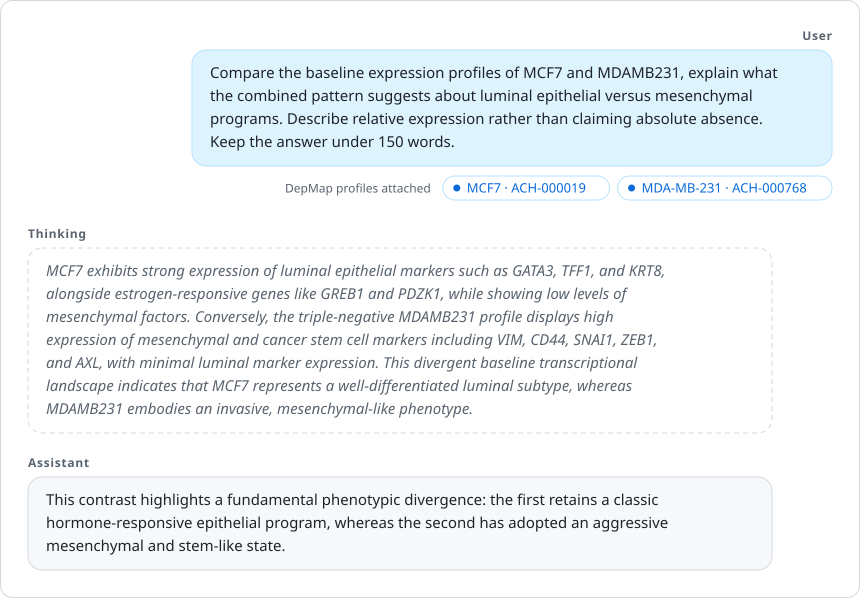

# Thalamus-Reasoning

Thalamus-Reasoning is a conversational language model trained to connect quantitative transcriptomic
measurements with biological knowledge. It takes bulk and single-cell expression profiles as input alongside text,
and was trained across 157 task groups, from cell-type annotation to perturbation-response prediction. The current
release is Thalamus-Reasoning-9B.

[Model on Hugging Face](https://huggingface.co/ingenix/Thalamus-Reasoning-9B) · [Paper (arXiv:2605.06728)](https://arxiv.org/abs/2605.06728)

This release differs from the model described in the paper. It does not use the Funomics input block, so every
input can be computed with public tools, and it was trained on a revised data mix, with rebalanced tasks and
quality fixes to several training datasets.

This repository holds the inference, data-preparation and evaluation code. The training code, training data
and reinforcement-learning pipeline are not released.

## Two ways to give the model a profile

**1. Name a cancer cell line.** The model repository includes expression profiles of 1,673 cell lines from
DepMap. The chat finds cell-line names in your message and attaches each line's profile automatically:

<p align="center">
  
</p>

The model also knows many cell lines by name, as any language model does. Without a profile, though, it can
only repeat what it has read; with the profile it can also draw on the line's measured expression.

**2. Use your own samples.** Convert your expression table (GEO counts, TPM, `.h5ad`) into profile vectors with
`tr-embed`, then refer to the samples by ID in the chat (`@GSM1001`).

Both work in the terminal chat, in the web app, and from Python.

## Install

Linux with an NVIDIA GPU of at least 24 GB (40 GB or more for vLLM), and Python 3.11–3.13.

```bash
git clone https://github.com/IngenixAI/Thalamus-Reasoning && cd Thalamus-Reasoning
uv sync --extra app --extra vllm          # chat, web app, vLLM
uv sync --all-extras                      # + evaluation, faster kernels, tests
```

With pip: `pip install -e ".[app,vllm]"` (the `eval` extra needs uv). Model files (about 19 GB) are downloaded
from the Hub on first use. To fetch them ahead of time, run `hf download ingenix/Thalamus-Reasoning-9B --local-dir
Thalamus-Reasoning-9B` and set `THALAMUS_REASONING_HOME=Thalamus-Reasoning-9B`.

## Chat about cell lines

```bash
uv run tr-chat      # terminal; add --thinking to let the model reason first
uv run tr-app       # web app at http://127.0.0.1:7860 (--share for a public link)
```

Write cell-line names in common spellings (`MCF7`, `mcf-7`, `ACH-000019`, `CVCL_0031`). Before each answer the
chat lists which names it matched; lines that are not in DepMap (for example HEK293T) stay plain text. Names
that are also ordinary words or gene symbols (`RD`, `KELLY`) are matched only when written as `@RD` or "RD
cells". `/lines breast` lists the available lines. The chat also tells the model that these profiles are
untreated baseline profiles from DepMap, which reduces invented experimental details in the answers.

## Ask about your own samples

The files below (`GSE123_counts.tsv.gz`, `cells.h5ad`, `mine.npz`) are not included in this repository; they stand
for your own data.

```bash
uv run tr-embed GSE123_counts.tsv.gz --out mine.npz     # bulk: TPM, FPKM, read counts or CPM
uv run tr-embed cells.h5ad --out cells.npz               # single cells: raw counts
uv run tr-chat --profiles mine.npz
you> Compare @GSM1001 and @GSM1004. Which one shows an interferon response?
```

`tr-embed` matches your genes to the model's 19,260-gene panel (Ensembl IDs, Entrez IDs or gene symbols),
detects whether the data is bulk or single-cell and whether bulk values are TPM or read counts, normalizes
them as in training, and writes a `.report.json` with gene coverage, what it detected and warnings. In the web
app, the upload panel does the same (up to 200 profiles and 200 MB per file). Cell-line names keep working in
the same conversation, so you can compare your samples with DepMap lines.

Preparing data correctly matters more than anything else. Read
[`skills/thalamus-reasoning-prepare-profiles/SKILL.md`](skills/thalamus-reasoning-prepare-profiles/SKILL.md) first. It is written
for people and for coding agents.

## Use from Python

```python
from thalamus_reasoning import ThalamusReasoning, load_profiles
from thalamus_reasoning.depmap import DEPMAP_SYSTEM, DepMap

lm = ThalamusReasoning.load()

# Cell-line names get their DepMap profile: res.text has an <omics> placeholder after each name.
# DEPMAP_SYSTEM tells the model these are untreated baseline profiles, as the chat does.
res, vectors = DepMap().resolve(
    "Compare the baseline expression profiles of MCF7 and MDAMB231, explain what the combined pattern suggests "
    "about luminal epithelial versus mesenchymal programs. Describe relative expression rather than claiming "
    "absolute absence. Keep the answer under 150 words.")
print(lm.ask(res.text, vectors, system=DEPMAP_SYSTEM))

# Your own samples, from tr-embed (mine.npz is your own file, not included in this repository)
mine = load_profiles("mine.npz")
print(lm.ask("Sample A: <omics>\nSample B: <omics>\nWhich sample shows stronger interferon signalling? Explain briefly.",
             [mine["GSM1001"], mine["GSM1004"]]))
```

`<omics>` marks where a profile goes; pass one vector per placeholder, in order. Other entry points:

- `lm.classify(question, vectors, labels)` chooses between candidate labels.
- `lm.chat(messages, vectors, thinking=True)` handles multi-turn conversations; `thalamus_reasoning.chat.Conversation`
  adds the chat's cell-line replacement.
- `thalamus_reasoning.batch.causal_inference(model_path(), prompts, vectors_per_prompt, system=...)` runs many prompts at
  once with vLLM (`model_path` is in `thalamus_reasoning.hub`).

## How a profile becomes a vector

Each profile is a 20,029-value vector, built as during training. Bulk and single-cell profiles go through
the same steps; only the first value differs.

| Block | Size | Computation |
|---|---|---|
| Data-type flag | 1 | bulk = 0, single-cell (cells or pseudobulk) = 1; z-scored |
| Expression | 19,260 | panel genes → scale to 10⁶ total → log1p → minus per-gene training mean → ÷ 1.535 |
| Geneformer-V2-104M | 768 | `<cls>` embedding (second-to-last layer) of the rank-value-encoded profile; z-scored |

The flag tells the model to expect sparse single-cell profiles. Bulk read counts and CPM are converted to TPM
first, because the bulk training data was TPM. `tr-embed` detects both; the
[skill guide](skills/thalamus-reasoning-prepare-profiles/SKILL.md) explains how. The gene panel and training statistics
are in `preprocessing/` in the model repository.

## Evaluation

| Task | Metric | Thalamus-Reasoning-9B | Best baseline |
|---|---|---|---|
| Tabula Sapiens, cell type (top 20) | macro AUROC | 0.920 | 0.948 (CellWhisperer) |
| Tabula Sapiens, tissue | macro AUROC | 0.874 | 0.760 (CellWhisperer) |
| Human Diseases, disease subtype | macro AUROC | 0.943 | 0.839 (CellWhisperer) |
| Human Diseases, tissue | macro AUROC | 0.987 | 0.932 (CellWhisperer) |
| GEO-OmicsQA, yes/no (2 × 500 questions) | accuracy | 0.765 | 0.662 (Gemini 3.8 Flash) |
| GEO-OmicsQA, free text (4 × 500 questions) | judge score | 0.663 | 0.613 (Gemini 3.8 Flash) |
| PerturbQA, direction of change | mean AUROC | 0.761 | 0.688 (SynthPert) |

Baseline scores and protocols are from the [paper](https://arxiv.org/abs/2605.06728). Thalamus-Reasoning-9B was
scored on Tabula Sapiens and Human Diseases subsets of 1,000 profiles per task (`eval/` in the model repository);
the baselines on other random samples of the same datasets. SynthPert's score is as reported by its authors.

`eval/` runs the model on the benchmark tasks used in the paper. Inputs (profile vectors, labels, questions)
come from the model repository's `eval/` folder and are downloaded on first use.

| Task | Command | Metric |
|---|---|---|
| GEO-OmicsQA | `uv run python eval/benchmark_geo_qa.py --workers 4` | accuracy (binary), judge score (free text) |
| Human Diseases | `uv run python eval/benchmark_classification.py --benchmark human_diseases --workers 2` | macro AUROC |
| Tabula Sapiens | `uv run python eval/benchmark_classification.py --benchmark tabula_sapiens` | macro AUROC |
| PerturbQA | `uv run python eval/benchmark_perturbqa.py run --output runs/pqa --workers 4` | mean AUROC, macro-F1 |

- `--workers` is the number of GPUs.
- GEO-OmicsQA free-text answers are scored by a Gemini judge (`gemini-3.1-flash-lite`) through DeepEval.
  Set your own `GOOGLE_API_KEY` (or Vertex AI credentials); no key ships with this repository.
- Human Diseases and Tabula Sapiens use 1,000-profile subsets per task. Human Diseases is the slowest
  (about 2 hours on 2 H100s); the others take 5–20 minutes.
- PerturbQA downloads the official labels and evaluator from Genentech/PerturbQA. The labels are CC BY 4.0;
  the evaluator code is under the Genentech Non-Commercial Software License. `--output` must be a new folder.
- GEO-OmicsQA decodes greedily; Human Diseases and Tabula Sapiens score the candidate labels. PerturbQA, as in
  the paper, samples three answers per question (temperature 0.6, top-p 0.9) and averages them.
- Scores vary slightly between runs (sampled answers, LLM judge, vLLM).

## Limitations

- For research only, not for clinical decisions.
- Human RNA-seq only. Microarrays, other assays and other species are out of distribution. `tr-embed`
  checks the input and reports what it detected and any problems; read its report before trusting answers.
- The model can be fluent and confidently wrong. It may invent details such as treatments, donor information
  or mutations, and it is unreliable for exact fold changes or for naming a perturbed gene. State what you
  know about the samples in the prompt, and check important claims.
- Choosing between candidate labels listed in the prompt (`lm.classify`) is more reliable than open-ended
  identification of tissue or cell type.
- DepMap profiles describe cancer cell lines in culture, not tumours.

## Support

Questions and bug reports: [GitHub Issues](https://github.com/IngenixAI/Thalamus-Reasoning/issues).
Contact: [info@ingenix.ai](mailto:info@ingenix.ai).

## License

Code is released under the [Apache License 2.0](LICENSE) (see [NOTICE](NOTICE)). The model weights are
released under the [Ingenix.ai License](https://huggingface.co/ingenix/Thalamus-Reasoning-9B/blob/main/LICENSE) and derive from [Qwen3.5-9B](https://huggingface.co/Qwen/Qwen3.5-9B) (Apache 2.0).
Data files in the model repository keep their own terms; see its README.

## Citation

```bibtex
@article{sypetkowski2026thalamus,
  title   = {Thalamus-Reasoning: A Multimodal Large Language Model for Multi-Sample Omics Reasoning},
  author  = {Sypetkowski, Maciej and Smoliński, Łukasz and Kinas, Remigiusz and Krawczyk, Joanna and
             Hofman, Bartłomiej and Możwiłło, Aleksandra and Pikusa, Michał and Jetka, Tomasz and
             Powalski, Rafał},
  journal = {arXiv preprint arXiv:2605.06728},
  year    = {2026},
  url     = {https://arxiv.org/abs/2605.06728}
}
```

Please also cite [Qwen3.5](https://huggingface.co/Qwen/Qwen3.5-9B) and
[Geneformer](https://huggingface.co/ctheodoris/Geneformer). If you use the evaluation data, cite DepMap,
CellWhisperer, Tabula Sapiens and PerturbQA.
